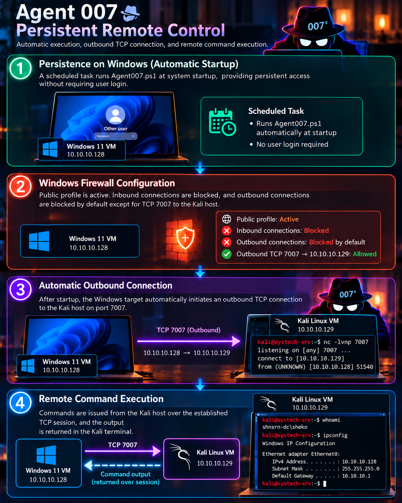

# Agent 007 — Persistent Remote Control Lab

A Windows–Kali cybersecurity laboratory project exploring **outbound TCP communications, Windows Firewall policy, remote PowerShell command execution, and startup persistence**.

**Author:** Shekoufeh Neisarian  
**Project:** CyberSteps — Project 7 (September 2026)

## Project at a glance

| Component | Laboratory configuration |
| --- | --- |
| Windows endpoint | Windows 11 VM — `10.10.10.128` |
| Linux endpoint | Kali Linux VM — `10.10.10.129` |
| Virtual network | VMware NAT, `10.10.10.0/24` |
| Transport | Outbound TCP from Windows to Kali on port `7007` |
| Firewall experiment | Inbound blocked; outbound denied by default, with a specific allow rule for TCP 7007 to Kali |
| Startup experiment | Windows Task Scheduler starts the agent before interactive logon, under `NT AUTHORITY\SYSTEM` |

## Included files

- **`Agent007.ps1`** — The full-command-execution version of the PowerShell agent, reproduced from the final report appendix (pages 20–23). It contains an outbound TCP client, reconnection handling, command processing and response output. The startup scheduled-task setup is a *separate laboratory configuration*, not part of this script.
- **`Agent-007-Infographic.png`** — A four-stage visual walkthrough showing startup persistence, firewall policy, outbound connection and command execution.

## Demonstrated observations

The laboratory showed that an allow-listed outbound connection can carry interactive application traffic even when unsolicited inbound traffic is blocked. The project also examined how startup tasks and highly privileged execution affect endpoint risk.

This experiment highlights why firewall rules alone are not sufficient to authorize or trust a process. Useful defensive controls include process and network telemetry, scheduled-task auditing, least-privilege execution, application control, and restrictions on outbound destinations and applications.

## Security considerations

**For isolated, authorized laboratory environments only.** This historical demonstration script provides unrestricted command execution over an unauthenticated, unencrypted TCP connection. It is not a secure remote-administration solution; it must not be deployed to production endpoints or exposed to untrusted networks. The IP addresses in the infographic refer to the original isolated lab.

The project materials describe a proof of concept, not a hardened application. The infographic is an overview rather than an installation guide.
